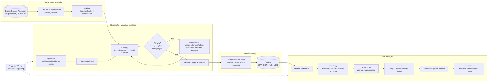

# Arquitetura da solução

## Visão geral

## Decisões de implementação

| Decisão | Alternativas consideradas | Motivo |
|---|---|---|
| Manter o mesmo pipeline e split da Fase 1 | Novo split, novo pré-processamento | Comparação justa: o otimizado é testado nas mesmas 114 pacientes que o original. |
| Codificação **híbrida** (int, real, log-real, categórica) | Binária | Hiperparâmetros têm tipos diferentes; a codificação direta nunca gera indivíduos inválidos. |
| Fitness = **F2 da classe maligna** em validação cruzada 5-fold | Accuracy; recall puro; F1; avaliar no teste | F2 pesa mais o recall (falso negativo = câncer não detectado), sem permitir o "chamar todos de maligno". CV evita vazamento do teste e reduz a variância de um único split (limitação apontada na Fase 1). |
| **Cache** de fitness | Re-treinar sempre | Elitismo e crossover repetem indivíduos; cada treino custa ~1 s. Mesma troca memória x processamento da tabela de distâncias da AG Aula 4. |
| Crossover **uniforme** + mutação **por gene** | OX e Swap (aulas de TSP) | OX/Swap existem para preservar permutações. Aqui os genes são independentes. |
| Mutação na escala **log** para `C` | Escala linear | `C` varia de 0,001 a 1000; passo linear ignoraria os valores pequenos. |
| Elitismo + parada por estagnação | Só número fixo de gerações | Garante que o melhor não se perde e economiza treinos quando o AG já convergiu. |
| Escolha do "melhor" pela **validação cruzada** | Escolher pelo teste | Escolher pelo teste seria otimizar no teste (overfitting de seleção). |
| LLM via **API compatível com OpenAI** | Rodar modelo local; fine-tuning | Custo e infraestrutura (LLMs Aula 5). O mesmo cliente atende Groq, OpenAI e Ollama (local, para quando os dados não podem sair do hospital). |
| LLM **só traduz** previsão + SHAP | LLM lê os dados brutos e "diagnostica" | A decisão continua no modelo validado; a LLM recebe tudo pronto (grounding), o que reduz alucinação e facilita auditar. |
| Modo **offline** | Exigir chave sempre | Testes automatizados rodam sem internet; o sistema não quebra sem chave. |

## Escalabilidade e monitoramento

O enunciado pede "recursos de escalabilidade automática" e deixa a nuvem como opcional (pontuação extra). O que foi implementado localmente:

- **Paralelismo**: a fitness usa `cross_validate(n_jobs=-1)`, então os 5 folds treinam em paralelo e usam todos os núcleos disponíveis, sem mudar o código. Numa máquina maior o AG fica mais rápido automaticamente.
- **Cache**: o número de treinos reais por geração cai conforme a população converge (ver coluna `new_evaluations` no histórico).
- **Monitoramento e logging**: cada geração registra melhor fitness, média, pior, diversidade, treinos novos e tempo, no console e em `logs/*.log`. Os históricos completos ficam em `results/resultados_completos.json`.

**Caminho para a nuvem** (ML na Cloud, Aulas 2 e 3), não implementado:

1. Registrar o dataset e o ambiente (`requirements.txt`) no Azure Machine Learning.
2. Rodar cada avaliação de fitness como um job num *compute cluster* com autoescala (mínimo de 0 nós, máximo de N). O cluster sobe máquinas quando a fila cresce e desliga quando esvazia. Essa é a "escalabilidade automática" do enunciado.
3. Avaliar a população de uma geração em paralelo (um job por indivíduo), como no *Hyperparameter Tuning/sweep* da Aula 3.
4. Publicar o modelo otimizado como *online endpoint* (Aula 2) e chamar a LLM a partir dele.
5. Trocar os logs em arquivo por métricas no próprio Azure ML (ou MLflow) para acompanhar os experimentos em painel.
